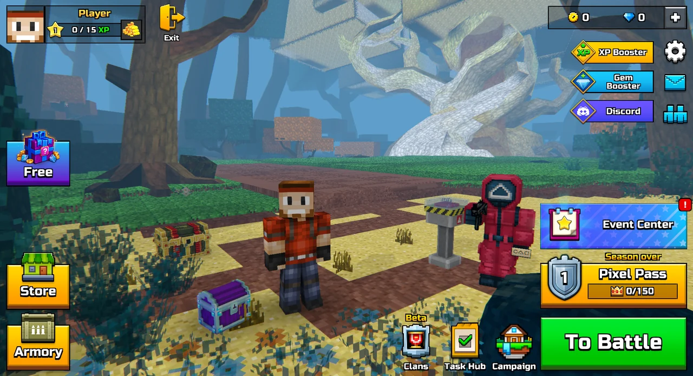
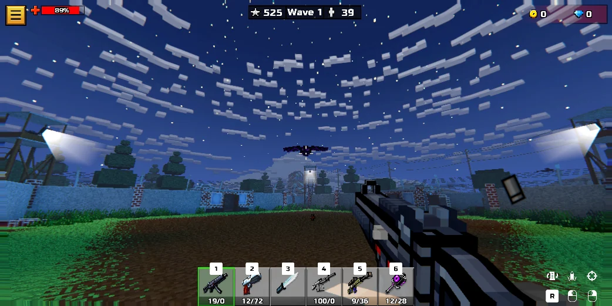
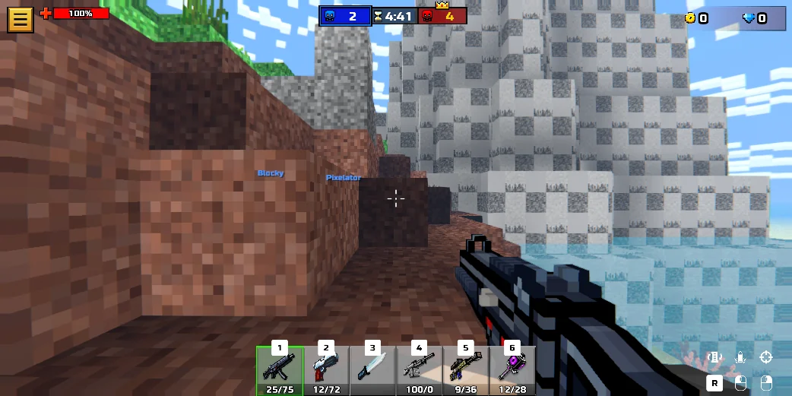
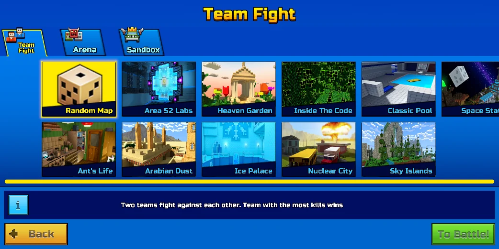
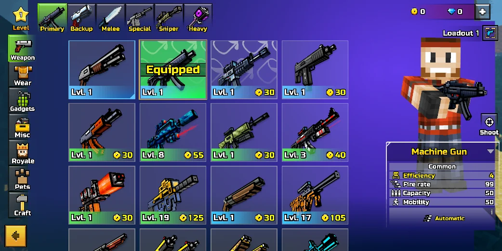

<div align="center">

# pg3d-rewrite

[](https://github.com/sjdsjadjajdjsa/pg3d-rewrite/actions/workflows/ci.yml)
[](https://github.com/sjdsjadjajdjsa/pg3d-rewrite/releases/latest)
[](LICENSE)
[](#play)
[](https://bevyengine.org)

A fan-made rewrite of Pixel Gun 3D in Rust, played offline with the content of your own copy of the game.



</div>

The whole game loop is rebuilt from scratch in [Bevy](https://bevyengine.org): movement, shooting, zombies, bots, menus and HUD. The maps, weapons, characters and screens are read from the Pixel Gun 3D you have installed, so this repository holds code only and no game files.

## What you get

- **Arena:** the zombie survival mode. Waves of 45 zombies, up to 10 at once, tougher types as the waves go on, with health and ammo pickups and TNT boxes.
- **Team Fight:** you and a team of bots against a red team, five minutes, most kills wins.
- **Sandbox:** any map with no enemies, to walk around and try weapons.
- **Up to 22 maps:** Arena, Heaven Garden, Ice Palace, Nuclear City, Classic Pool, Area 52 Labs, Sky Islands and more, each with its original lighting, colliders and navigation mesh.
- **The original menus:** lobby, game mode picker, Armory, settings (with key rebinding), pause and results screens, redrawn from the game's own layouts.
- **Weapons from the real game:** stats for every weapon, first-person models and animations, sounds, crosshairs and rockets. Pick your loadout in the Armory.
- **Saved progress:** level, XP, coins, gems and your loadout stay between sessions.

## Screenshots

| Arena | Team Fight |
| --- | --- |
|  |  |

| Picking a map | Armory |
| --- | --- |
|  |  |

## Play

You need **Pixel Gun 3D: PC Edition**, installed from [Steam](https://store.steampowered.com/app/2524890/) (it's free).

Then download the newest version from [Releases](https://github.com/sjdsjadjajdjsa/pg3d-rewrite/releases/latest):

| | Download | Run |
| --- | --- | --- |
| **Linux** | `pg3d-rewrite-x86_64.AppImage` | Mark it executable (right-click, Properties, or `chmod +x`) and run it. Needs glibc 2.35 or newer (Ubuntu 22.04, Fedora 36, Arch and so on). It keeps the imported files in `~/.local/share/pg3d-rewrite`. `pg3d-rewrite-linux-x86_64.tar.gz` is the same as a plain folder. |
| **Windows** | `pg3d-rewrite-setup-x86_64.exe` | Run it. Installs for your user only, with no admin rights, and adds a Start menu entry. |

Windows will say the publisher is unknown, as the program isn't signed: click "More info", then "Run anyway". `pg3d-rewrite-windows-x86_64.zip` is the same without an installer. Both downloads bring their own Python for the import, so there's nothing else to install.

The first start opens an import screen. It finds Pixel Gun 3D in your Steam libraries, or you pick or drop the game's folder on the window. Press **Import**, wait about ten minutes, then **Play**. The import only reads the game's files and never changes them, and it needs the internet once, for its Python packages. When Pixel Gun 3D updates, the import screen comes back on the next start and offers to import again.

### Game versions

The import works with the current Steam version: menus, HUD, weapons, zombies and the maps your install has. Pixel Gun 3D downloads most maps only when you play them, so a fresh install has about six (play a few modes in the real game to get more).

For all 22 maps at once, download the October 2026 build alongside your normal install. Open Steam's console (`steam steam://nav/console` on Linux, or paste `steam://nav/console` into a browser) and enter:

```
download_depot 2524890 2524891 8917309360682204919
```

When Steam says "Depot download complete", press **Choose folder...** on the import screen and pick the folder it names.

## Build it yourself

Needs [Rust](https://rustup.rs) and [Python](https://www.python.org/downloads/) 3.9 or newer (on Windows, tick "Add python.exe to PATH"). On Linux you also need the usual Bevy libraries. On Debian or Ubuntu:

```
sudo apt install build-essential pkg-config libasound2-dev libudev-dev libwayland-dev libxkbcommon-dev python3-venv
```

Then:

```
git clone https://github.com/sjdsjadjajdjsa/pg3d-rewrite
cd pg3d-rewrite/game
cargo run --release
```

`cargo run --release -- --setup` opens the import screen again.

## Controls

| Where | Keys |
| --- | --- |
| **In a match** | `WASD` move, `Space` jump, mouse aims, left click fires, right click zooms, `R` reload |
| **Weapons** | `1` to `9` or the mouse wheel |
| **Anywhere** | `Esc` pause, `F10` back to the menu, `F12` screenshot, `V` free camera |

Click the window once to capture the mouse. Every key can be changed in Settings, on the keyboard tab.

## How it works

| Folder | What |
| --- | --- |
| [`game/`](game) | the rewrite: Rust and Bevy, with [avian3d](https://github.com/avianphysics/avian) physics |
| [`exporter/`](exporter) | Python scripts that read your install with [UnityPy](https://github.com/K0lb3/UnityPy) and write glTF models, textures, sounds and JSON |

The import screen runs `exporter/scripts/setup.py`, which sets up its own Python environment in `exporter/tools/` and writes everything to `exporter/private/export/`. Both folders are ignored by git. [game/README.md](game/README.md) lists every part of the game and its debug options, and [exporter/README.md](exporter/README.md) every exporter.

## License

[MIT](LICENSE), for the code in this repository. Pixel Gun 3D and everything the import reads from it belong to Cubic Games. This is a fan project, not affiliated with or endorsed by Cubic Games.
